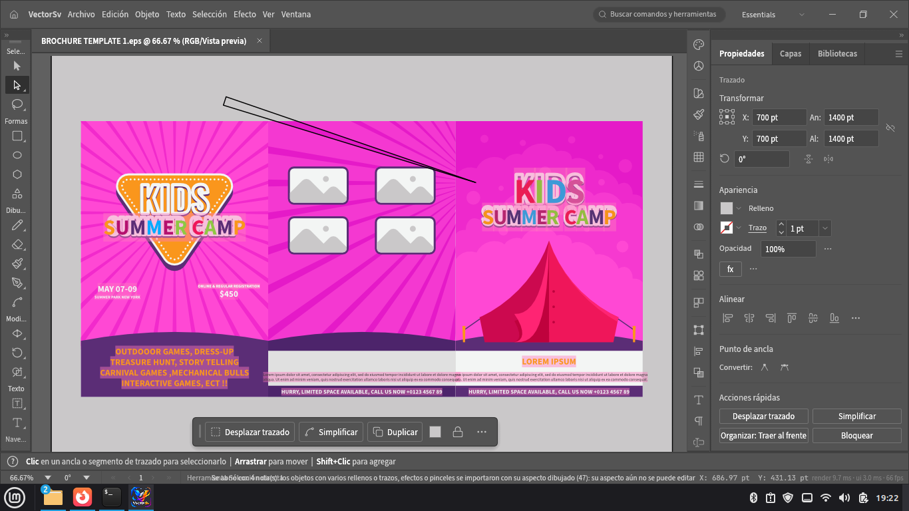
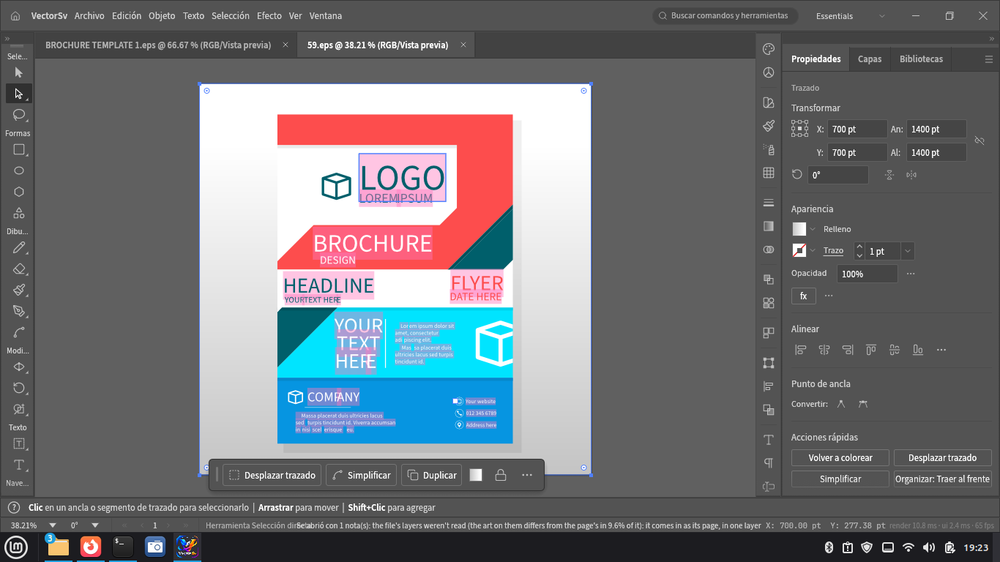
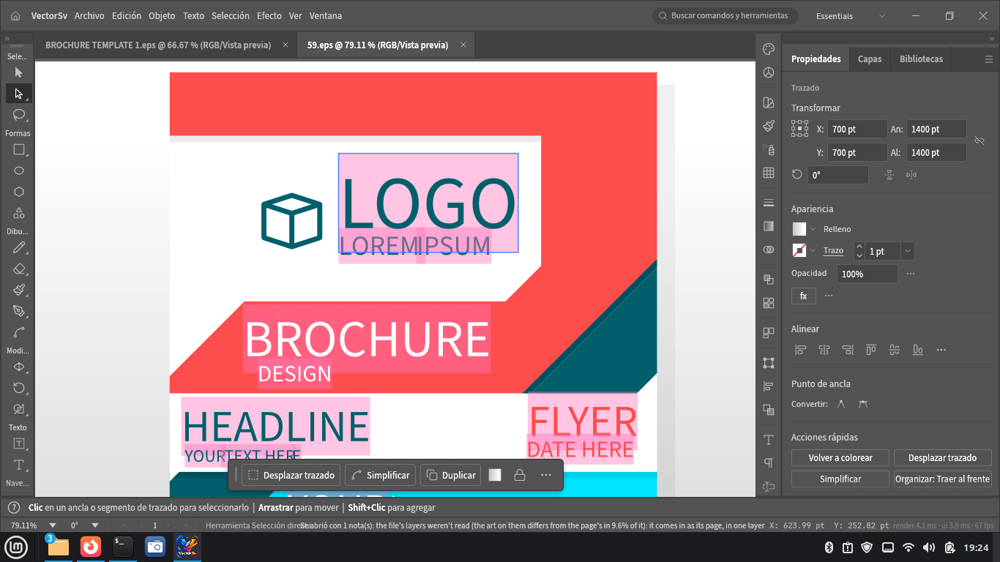
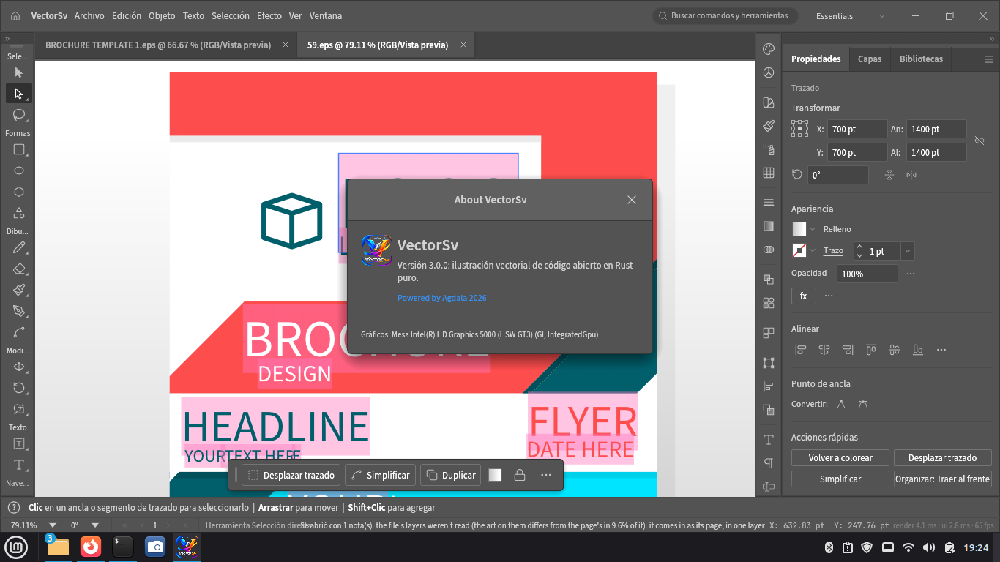

# VectorSv 4.0 — Ilustración vectorial libre y gratuita

**VectorSv** es un editor de gráficos vectoriales gratuito y de código abierto: la alternativa libre a Adobe Illustrator, sin suscripciones ni nube obligatoria. Dibuja con la pluma Bézier, trabaja con texto, degradados, mesas de trabajo y efectos en vivo, y abre tus archivos **EPS, SVG, PDF e Illustrator (.ai)** tal cual. Escrito en Rust puro: rápido (60+ fps con GPU), estable y privado.

- 🌐 **Página oficial:** publícala con GitHub Pages desde este repositorio (`index.html`)
- 💾 **Descargas:** carpeta [`downloads/`](downloads/) — `.deb`, `.rpm` y `.AppImage` para Linux x86_64
- 📧 **Contacto:** agdala.sv@gmail.com
- ⚖️ **Licencia:** MIT / Apache-2.0 · **Power by Agdala 2026**

## Descargar VectorSv 4.0 (Linux x86_64)

| Paquete | Para | Instalación |
|---|---|---|
| [`vectorsv-4.0.0-linux-x86_64.deb`](downloads/vectorsv-4.0.0-linux-x86_64.deb) | Debian, Ubuntu, Mint, Pop!_OS… | `sudo dpkg -i vectorsv-4.0.0-linux-x86_64.deb` |
| [`vectorsv-4.0.0-linux-x86_64.rpm`](downloads/vectorsv-4.0.0-linux-x86_64.rpm) | Fedora, openSUSE, RHEL… | `sudo rpm -i vectorsv-4.0.0-linux-x86_64.rpm` |
| [`vectorsv-4.0.0-linux-x86_64.AppImage`](downloads/vectorsv-4.0.0-linux-x86_64.AppImage) | Cualquier distro, sin instalar | `chmod +x vectorsv-4.0.0-linux-x86_64.AppImage && ./vectorsv-4.0.0-linux-x86_64.AppImage` |

## Características

- **Pluma Bézier de precisión:** trazados, nodos y puntos de ancla con control total.
- **Abre EPS, AI y PDF** conservando capas, texto y estilos; guarda en `.vectorsv`, `.vctemplate`, PDF, SVG y EPS.
- **Texto profesional,** degradados, transparencias, modos de fusión, símbolos y estilos gráficos.
- **Capas, mesas de trabajo,** guías, cuadrículas y reglas.
- **Recuperación automática** de documentos y formato nativo `.vectorsv` versionado.

## Galería — VectorSv en acción

Archivos EPS reales abiertos y editados en VectorSv:

*Folleto tríptico EPS · trazados y texto editables*

*Volante corporativo EPS · capas y estilos intactos*

*Edición de nodos al detalle*

*Acerca de VectorSv · Power by Agdala 2026*

## Publicar la página (GitHub Pages)

1. Crea el repositorio en GitHub (por ejemplo `vectorsv`) y sube este proyecto.
2. En el repositorio: **Settings → Pages → Deploy from a branch → `main` / `/ (root)`**.
3. Tu página quedará en `https://<tu-usuario>.github.io/vectorsv/`.
